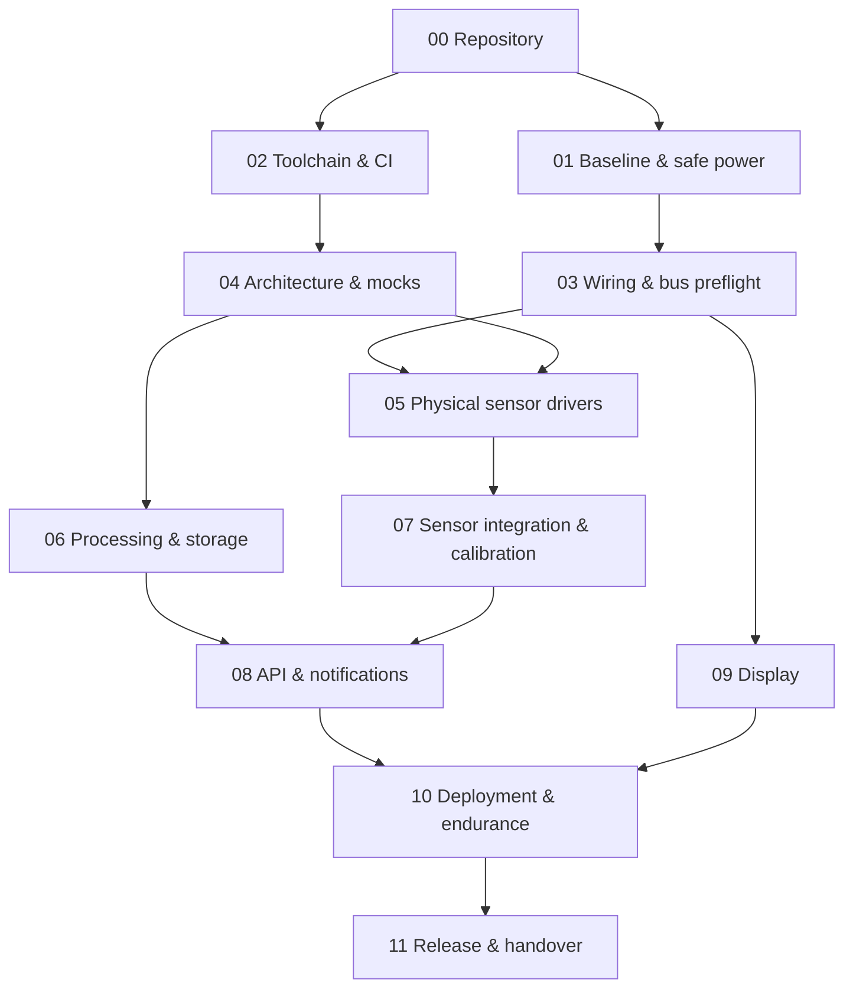

# Project Stingray — Master Implementation Plan

**Document:** `STINGRAY_IMPLEMENTATION_PLAN.md`  
**Version:** 1.0 (planning baseline)  
**Status:** Proposed — not executed  
**Target release:** `v1.0.0`  
**Repository:** `project_stingray` (to be created)  
**Execution owner:** Project implementer; this document defines scope, implementation, tests and gates.

> **How to use this document:** Execute phases in order unless a phase explicitly allows parallel work. Treat each numbered task as a Jira-ready story. Do not mark a phase complete because code was written: close it only after its acceptance criteria pass and evidence is committed or linked. Replace assumptions only after recording the verified hardware facts in `docs/hardware/inventory.md`.

---

## 1. Mission and success definition

Migrate the existing ESP32-S3 air-quality monitoring application to a **Raspberry Pi 4 Model B Rev 1.1** (host: `stingray`) with sensor parity, operational reliability, and maintainable software. All source, deployment configuration, tests, documentation, and verification artifacts belong in a new Git repository.

### Required feature parity

| Capability | Required in v1.0 | Notes |
|---|---|---|
| SPS30 particulate matter | Yes | PM mass and available number-concentration channels |
| SCD4x | Yes | CO₂, temperature, RH; obey device timing |
| SHT45 | Yes | Temperature and relative humidity |
| SGP41 | Yes | Raw signals plus correct VOC/NOx Gas Index processing |
| ILI9341 2.8-inch SPI display | Yes | Must not interfere with acquisition |
| HTTP `/api/status` | Yes | Preserve existing ESP32 contract wherever possible |
| HTTP `/api/history` | Yes | Preserve 60-minute history semantics; also durable history |
| Telegram alerts | Yes | Debounce/cooldown and failure handling |
| Local network access | Yes | No required cloud dependency |
| Data persistence | Yes | SQLite with retention and backups |
| Automatic startup/recovery | Yes | systemd, least privilege, structured logs |
| Diagnosability | Yes | Sensor health, power, CPU temp, logs |
| Mock mode | Yes | Hardware-independent automated tests |
| Dashboard | Optional enhancement after parity | Do not block v1.0 unless explicitly promoted to required scope |
| Docker | Not required in v1.0 | Native Python + systemd first |

### Explicit non-goals for v1.0

- Do not add Kubernetes, a message broker, TimescaleDB, InfluxDB, or another full observability stack by default.
- Do not replace the physical sensor set or invent extra features before compatibility is verified.
- Do not assume that the DFR0918 supplies independently regulated peripheral power; it is a GPIO terminal breakout.
- Do not power 5 V signals into Raspberry Pi GPIO, which uses 3.3 V logic.
- Do not require Internet connectivity for local sensing, storage, display, or API.
- Do not commit credentials, databases, generated logs, virtual environments, or hardware-generated personal network details.

### Existing baseline (reverify, not accepted as current evidence)

- Raspberry Pi 4B Rev 1.1; Debian 13 Trixie; ARM64; ~2 GiB RAM; SD-card root filesystem.
- Previously verified `/dev/i2c-1`, `/dev/spidev0.0`, `/dev/spidev0.1`, and `get_throttled=0x0`.
- DFRobot DFR0918 terminal-block HAT; raised over an aluminum case with two fans.
- **Known risk:** Pi has reportedly booted only with fan disconnected. This is an open blocker until electrically diagnosed and resolved.
- Existing ESP32 air monitor has `/api/status`, `/api/history`, ~60-minute history, Telegram alerts, mDNS, and an ILI9341 display. **Capture actual firmware, payloads, intervals and thresholds before implementing compatibility.**

## 2. Execution method and governance

### Issue structure and workflow

- **Epics:** one per phase, labeled `STG-P00` through `STG-P11`.
- **Stories:** `STG-001` onward as listed in each phase; when moving to Jira use actual Jira-generated issue IDs if they differ.
- **Workflow:** `Backlog → Ready → In Progress → In Review → Validation → Done` (or `Blocked`).
- **Branch names:** `feature/STG-###-short-description`; bug fixes `fix/STG-###-short-description`.
- **Pull requests:** link task, tests performed, before/after behavior, safety impact, and attached evidence.
- **Release tags:** semantic versions; first production release `v1.0.0`.

### Definition of Ready (all stories)

- Outcome and boundaries understood; prerequisites documented.
- Code/files expected to change identified.
- Acceptance criteria are testable; proposed commands/measurements are specified.
- Hardware and electrical risks reviewed if relevant.

### Definition of Done (all stories)

- Implementation committed; quality checks pass; tests and runbooks updated.
- Expected failure and recovery behavior tested where applicable.
- Acceptance evidence saved under `reports/phase-XX/` or linked from Jira.
- No unresolved safety issue or critical regression; phase gate has explicit PASS/FAIL/BLOCKED result.

### Evidence conventions

Every phase produces `reports/phase-XX/README.md` including: execution date, OS/kernel, Git SHA, configuration revision (with secrets redacted), test command, observed result, expected result, deviation, PASS/FAIL/BLOCKED and follow-up issues. Store abbreviated logs and machine-readable results; avoid large raw databases in Git. Store sensitive or oversized evidence externally and link it.

### Phase dependency rules



**Stop-work rule:** Any unexpected power instability, hot wiring, overvoltage, backfeed, damaged connector or repeated brownout stops hardware tests immediately. Continue only software/mock work until the cause is resolved.

---

## Phase 00 — Repository bootstrap and scope capture

**Epic:** `STG-P00`  
**Goal:** Create a clean Git repository and record the behavior we are migrating.  
**Prerequisites:** Git host selected; access credentials available.  
**Deliverables:** Repository skeleton, project charter, ESP32 parity specification, working agreements.

### STG-001 — Create `project_stingray`

**Implementation**
1. Create an *empty* private or appropriately access-controlled remote repository named `project_stingray`.
2. Clone on development computer and Pi (avoid blindly overwriting existing directories).
3. Add `.gitignore`, `.editorconfig`, `README.md`, `LICENSE` (after choosing a license), `CHANGELOG.md`, `CONTRIBUTING.md`, `pyproject.toml`, `.env.example` and directories below.
4. Decide remote workflow (GitHub/GitLab), branch protection and CI provider.
5. Require PRs for `main`; use issue identifiers in commits/PRs.

```text
project_stingray/
├── README.md
├── STINGRAY_IMPLEMENTATION_PLAN.md
├── pyproject.toml
├── uv.lock                       # after dependency resolution
├── .env.example
├── .gitignore
├── .editorconfig
├── config/
│   ├── application.example.yaml
│   ├── sensors.example.yaml
│   └── hardware.example.yaml
├── src/stingray/
│   ├── __init__.py
│   ├── main.py
│   ├── core/
│   ├── hardware/
│   ├── sensors/
│   ├── processing/
│   ├── storage/
│   ├── api/
│   ├── display/
│   ├── alerts/
│   └── observability/
├── tests/
│   ├── unit/
│   ├── integration/
│   ├── hardware/
│   └── fixtures/
├── scripts/
├── deploy/systemd/
├── docs/
│   ├── adr/
│   ├── architecture/
│   ├── hardware/
│   ├── compatibility/
│   ├── development/
│   └── operations/
└── reports/                    # short reports only
```

**Acceptance criteria**
- [ ] Remote and local repository exist; clean checkout succeeds on Pi and development machine.
- [ ] `main` contains only approved scaffolding; no prebuilt application archive imported.
- [ ] Secrets, `.venv`, `*.db`, logs and generated reports with private data are ignored.
- [ ] README states purpose, supported hardware, setup prerequisites and execution order.
- [ ] Branch/PR strategy documented and applied.

**Evidence:** repository URL, initial commit SHA, clean clone output and branch-policy screenshot/export.

### STG-002 — Capture old ESP32 behavior (migration contract)

**Implementation**
1. Archive current ESP32 code revision separately without altering it.
2. Record genuine example responses of `/api/status` and `/api/history` with timestamps and units; redact IPs/tokens.
3. Record collection intervals, retention, Telegram thresholds and quiet periods, display pages, error behavior, boot behavior, and mDNS names.
4. Save contract fixtures in `tests/fixtures/esp32/` and document differences permitted on Pi.
5. Add a parity matrix tracking each ESP32 feature (`baseline`, `planned`, `implemented`, `verified`).

**Acceptance criteria**
- [ ] Both API payloads captured and schema described field-by-field.
- [ ] History duration and resolution, missing-data representation and timestamps documented.
- [ ] Alerts and display parity documented with screenshots/examples.
- [ ] Every required legacy feature maps to a future phase/test.
- [ ] Unknown behaviors called out explicitly; none silently assumed.

**Evidence:** `docs/compatibility/esp32-parity.md`, redacted fixtures and parity matrix.

**Phase 00 exit gate:** Repository is usable and the migration target is objectively specified. Do **not** write actual hardware code before Phase 01 power gate.

---

## Phase 01 — Baseline, power, boot and cooling safety

**Epic:** `STG-P01`  
**Goal:** Establish a reproducibly stable Pi before attaching all components.  
**Prerequisites:** Phase 00; a safe known-good Pi power adapter, appropriate measuring equipment if available.  
**Deliverables:** Hardware inventory, preflight command/script, power root-cause report and thermal baseline.

### STG-003 — Capture system inventory

**Implementation:** Save outputs of `hostnamectl`, `/etc/os-release`, `uname -a`, `cat /proc/device-tree/model`, `free -h`, `lsblk`, `df -h`, `id`, I²C/SPI device presence, `vcgencmd get_throttled`, `vcgencmd measure_temp`, `systemctl --failed`, OS power configuration, SSH access. Do not commit credentials or identifying network details. Create `scripts/preflight.sh` producing machine-readable status and human-readable failure messages.

**Acceptance criteria**
- [ ] Baseline report has OS, kernel, hardware revision, memory, storage, interface and throttling information.
- [ ] SSH reconnect and clean reboot verified.
- [ ] Preflight returns nonzero on missing mandatory device nodes or failed critical checks.
- [ ] Baseline collected before and after any electrical modification.

### STG-004 — Diagnose fan-related boot failures (critical blocker)

**Implementation:** With power disconnected before rewiring, inspect fan voltage/current labels, polarity, connector locations, supply ratings and any shared GPIO/HAT rails. Perform staged tests: (A) Pi only, (B) Pi + HAT, (C) Pi + approved fan supply, (D) CPU load, (E) final connected power topology. Never connect an unidentified fan directly to GPIO, use 5 V on logic pins, or link separate 5 V supplies without an intentional reviewed design. If a meter is unavailable, use documented connector/fan specifications and acquire a meter before claiming voltage or current values were measured. Consider a separate regulated fan supply or appropriately designed switching circuit if needed.

**Acceptance criteria**
- [ ] Original fan boot issue reproduced or an evidence-backed explanation recorded.
- [ ] Final supply and fan connection diagram approved.
- [ ] Five consecutive cold boots succeed with intended cooling configuration.
- [ ] No new current/historical undervoltage or throttling flags during boot and test window (interpret bitmask correctly; historical flags require baseline/controlled reset).
- [ ] No unexplained resets under sustained CPU load.
- [ ] Any changed power design is documented with voltage/current limits and protection.

### STG-005 — Establish cooling/SD-card operational baseline

**Implementation:** Sample temperature and throttling every 5 seconds for idle and sustained workload; record fan operation, ambient estimate, CPU/memory load, SD-card free space and disk errors. Configure time synchronization and timezone representation (UTC in storage; user-facing timezone configurable). Choose conservative test workloads; monitor in parallel.

**Acceptance criteria**
- [ ] Ambient and device temperature profiles available, with fans enabled.
- [ ] Target sustained temperature <75°C and zero throttling under planned workload (project target, not hardware guarantee).
- [ ] No kernel I/O errors during tests; free storage sufficient for planned retention.
- [ ] Safe shutdown and SD-card backup method documented.

**Phase 01 exit gate:** **POWER_STABLE = PASS**. Physical sensor wiring cannot begin if this gate is blocked. Mock/application work may continue independently.

---

## Phase 02 — Toolchain, local workflow and CI

**Epic:** `STG-P02`  
**Goal:** Make code development and testing repeatable on Mac and ARM64 Pi.  
**Prerequisites:** Phase 00; SSH access.  
**Deliverables:** Locked dependencies, quality tools, CI, contributor guide.

### STG-006 — Set up Python project and diagnostics

**Implementation:** Use Python 3 supported by the installed Debian release; record exact version. Adopt `uv` with `pyproject.toml` and committed `uv.lock`; run an isolated project environment. Include runtime dependencies only when needed. Developer tools: `pytest`, `pytest-cov`, `ruff`, `mypy`, `httpx`, mocks. OS diagnostics: `i2c-tools`, `gpiod`, `spi-tools` if available, `jq`, `tmux`, `git`, `sqlite3`, `vcgencmd` where available. Verify distribution package availability rather than forcing installation. Check wheels/compilation on aarch64.

**Acceptance criteria**
- [ ] Fresh clone can install using documented commands and lockfile.
- [ ] No global pip modifications / `--break-system-packages`.
- [ ] `uv run pytest`, `uv run ruff check .`, and configured type checks complete.
- [ ] Dependency install works on Pi (ARM64) and development environment.
- [ ] Hardware-only dependencies do not prevent mock tests on Mac.

### STG-007 — Configure CI and developer commands

**Implementation:** Create workflows for lint, static typing, unit/integration tests, package build. Provide a Makefile or task shortcuts (`setup`, `lint`, `format-check`, `typecheck`, `test`, `test-hardware`, `run-mock`). Mark physical tests `@pytest.mark.hardware` and exclude them in normal CI. Pin action versions and minimize permissions.

**Acceptance criteria**
- [ ] PR pipeline runs without Pi or sensors.
- [ ] Deliberately introduced lint/test failure causes non-green pipeline.
- [ ] Test results and coverage summary are archived.
- [ ] CI never requires Telegram credentials or actual GPIO access.

**Phase 02 exit gate:** Two machines can reproduce development/test results; no manual hidden setup.

---

## Phase 03 — Wiring specification and bus preflight

**Epic:** `STG-P03`  
**Goal:** Finalize physical connectivity without damaging sensors or Pi.  
**Prerequisites:** Phase 01 PASS; hardware datasheets in hand.  
**Deliverables:** Verified schematic, power budget, GPIO map and bus checks.

### STG-008 — Power and pin design review

**Implementation:** Record exact breakout/module revisions, not just bare sensor chip models. Create `docs/hardware/wiring.md`, `pinout.csv` and `power-budget.md` including per-module supply, logic level, peak/steady current, pull-ups, any level shifting, ground topology, and supply isolation. Account for the SPS30's specific supply/interface arrangement and ILI9341 board backlight circuitry. The DFR0918 provides accessible terminals; **do not treat it as an independently powered regulator**.

**Candidate Raspberry Pi 40-pin bus mapping (subject to actual display board):**

| Function | BCM GPIO | Physical pin |
|---|---:|---:|
| I²C SDA1 | 2 | 3 |
| I²C SCL1 | 3 | 5 |
| SPI MOSI0 | 10 | 19 |
| SPI MISO0 | 9 | 21 |
| SPI SCLK0 | 11 | 23 |
| SPI CE0 | 8 | 24 |
| TFT DC | 25 (candidate) | 22 |
| TFT RESET | 24 (candidate) | 18 |

**Expected I²C addresses to confirm by module documentation and scan:** SHT45 `0x44`, SCD4x `0x62`, SGP41 `0x59`, SPS30 `0x69` (if configured for I²C).

**Acceptance criteria**
- [ ] Pin-by-pin annotated wiring drawing approved.
- [ ] Every power rail and logic level validated against exact breakout datasheet.
- [ ] Current budget includes fans, peripherals and startup headroom.
- [ ] No unintentional regulator/supply backfeed, floating grounds or 5 V GPIO logic.
- [ ] Pull-up ownership and effective voltage documented; address conflicts ruled out.
- [ ] GPIO allocation has no overlaps including TFT control lines and fan drivers.

### STG-009 — Enable and test communication buses

**Implementation:** Inspect `/boot/firmware/config.txt` and device nodes after reboot; verify I²C, SPI and service-account permissions. Validate one device at a time before combining devices. Use `i2cdetect -y 1` only when compatible with attached devices and datasheets; some probes/transactions are not harmless on all devices. Use device-aware identification/commands for final confirmation. Check `/dev/spidev0.0` and run non-destructive TFT driver initialization only when wiring has passed STG-008.

**Acceptance criteria**
- [ ] I²C/SPI survive two reboots.
- [ ] Devices enumerated/communicate only after electrical sign-off.
- [ ] Expected address/identity documented per device.
- [ ] User/service account has only necessary device permissions.
- [ ] Bus failures show a useful diagnostic, not a silent success.

**Phase 03 exit gate:** **WIRING_APPROVED = PASS**, **BUSES_READY = PASS**.

---

## Phase 04 — Application foundation and mock mode

**Epic:** `STG-P04`  
**Goal:** Build the application core independent of connected hardware.  
**Prerequisites:** Phase 02; Phase 00 parity contract.  
**Deliverables:** Package, configuration, driver contracts, scheduler, mock simulation.

### STG-010 — Define architecture and schemas

**Implementation:** Use a layered architecture:

```text
HAL (I2C/SPI/GPIO drivers) -> acquisition/scheduler -> normalization
                                              |-> SQLite writer
                                              |-> live-state cache
                                              |-> API / display / alerts
```

Interfaces should support `initialize()`, `read()`, `health()`, `close()` and typed errors; distinguish initializing, ready, stale, degraded, disconnected and failed. Measurements include source, sensor ID, metric, value, unit, measurement timestamp (UTC), ingestion timestamp, quality and optional diagnostic metadata. Use immutable validated models and avoid returning arbitrary `NaN` in JSON. Write ADRs for sync/async bus access, failure isolation, database schema, and storage architecture.

**Acceptance criteria**
- [ ] All driver classes conform to common protocol tests.
- [ ] Unit/quality fields unambiguous; timestamps timezone-aware UTC.
- [ ] No hardware imports in API/storage tests unless optionally injected.
- [ ] Failure of one driver does not crash the sensor scheduler.
- [ ] Architecture and contracts documented.

### STG-011 — Configuration and secrets

**Implementation:** Define validated settings for `mode=mock|hardware`, sensor enable flags, cadence, SQLite path, API bind address, alerts, telemetry, retention, display orientation/refresh and log settings. Use example YAML and environment variables for secrets; no token in committed YAML. Define conservative defaults and reject incompatible combinations.

**Acceptance criteria**
- [ ] Invalid modes, negative intervals, missing required settings fail early.
- [ ] Hardware mode requires explicit user opt-in/config.
- [ ] No secret appears in logs, exceptions or source control.
- [ ] Config precedence and rollback documented; tests pass.

### STG-012 — Build scheduler and deterministic mock sensors

**Implementation:** Use independent sensor cadence with monotonic scheduling, data-ready checks as required, bounded retries/backoff, and serialized I²C transactions where necessary. Mock all four sensors with deterministic seeded readings and injectable failures (timeout, stale data, sensor disconnect, restart, bad CRC, disk unavailable). Handle SIGTERM gracefully.

**Acceptance criteria**
- [ ] Mock application runs continuously for >=30 minutes without hardware.
- [ ] All expected measurements available via internal state queue.
- [ ] Mock failures mark device unhealthy without halting other sources.
- [ ] Deterministic tests reproduce same measurement sequence.
- [ ] Clean shutdown releases tasks and locks within 10 seconds under normal conditions.

**Phase 04 exit gate:** `uv run pytest -m 'not hardware'` passes, mock app starts and recovers from injected sensor faults.

---

## Phase 05 — Integrate sensors individually

**Epic:** `STG-P05`  
**Goal:** Implement and verify each actual sensor driver before combining buses.  
**Prerequisites:** Phase 03 PASS + Phase 04 PASS.  
**Deliverables:** Four driver adapters, fixture tests, individual hardware reports.

**Driver selection rule:** Prioritize the current official Sensirion drivers and Gas Index algorithm, verify ARM64 compatibility and APIs, pin tested versions. Keep vendor code isolated behind our own interface. Never treat a visible I²C address as proof of successful sensing.

### STG-013 — SHT45 driver

**Tasks:** Initialize I²C at expected `0x44`; support precision/read timing; capture °C and RH; validate driver error/CRC handling; produce sample log.

**Acceptance criteria**
- [ ] 10 consecutive valid measurements with correct units/timestamps.
- [ ] Communication error and reconnection paths tested.
- [ ] Sensor contract tests pass for real and mock implementations.
- [ ] Results recorded with bus address, library version, test conditions.

### STG-014 — SCD4x driver

**Tasks:** Initialize at `0x62`; start periodic mode, honor data-ready and device cycle times; handle warm-up, CO₂ ppm, temperature/RH; document calibration, ASC and altitude/pressure compensation defaults.

**Acceptance criteria**
- [ ] 10 successful **data-ready cycles** (not 10 rapid reads).
- [ ] CO₂, temperature and RH returned with quality status.
- [ ] Sensor re-init and restart tested without invalid rapid polling.
- [ ] Calibration settings explicitly documented, not silently changed.

### STG-015 — SGP41 driver and Gas Index algorithm

**Tasks:** Read raw VOC/NOx sensing signals at the algorithm-recommended cadence; feed correct humidity/temperature compensation from healthy source; integrate Sensirion Gas Index implementation; represent startup/conditioning behavior and any algorithm state persistence supported by the chosen library. VOC/NOx Index is an algorithmic indicator **not a ppm measurement**.

**Acceptance criteria**
- [ ] Raw signals acquired and identifiable as raw values.
- [ ] Gas Index behavior verified against official examples/test vectors where available.
- [ ] Missing compensation has explicit documented fallback behavior.
- [ ] Conditioning/invalid/stale states reflected in output.
- [ ] 30-minute continuous sampling and restart test pass.

### STG-016 — SPS30 particulate sensor

**Tasks:** Check selected I²C interface and electrical pins/levels; initialize at expected `0x69` only if in I²C mode; start fan/measurement engine; read PM1, PM2.5, PM4, PM10 and supported number concentrations; observe startup/measurement timings, fan care and periodic cleaning guidance. Do not power sensor through weak GPIO output.

**Acceptance criteria**
- [ ] Supply behavior and communication mode electrically verified.
- [ ] 10 valid measurement cycles with PM values and units.
- [ ] Startup, stop, timeout, missing fan/data-ready conditions handled.
- [ ] No new undervoltage during SPS30 startup or sustained operation.
- [ ] Metadata (firmware/serial if available) recorded without exposing unnecessary identifiers.

### STG-017 — Per-sensor hardware regression harness

**Tasks:** Create opt-in `pytest -m hardware` checks; test single-device identification, health, 10 samples, timeout, reinitialization; tag any destructive/reset behavior explicitly and require opt-in.

**Acceptance criteria**
- [ ] Each device test isolated, repeatable and well documented.
- [ ] Test summary states connected device, pass/fail, sample count and timing.
- [ ] Hardware tests never run in ordinary CI by accident.
- [ ] No test requires sudo if normal service-account permissions suffice.

**Phase 05 exit gate:** Each driver independently passes contract + physical testing, and no power issue has reappeared.

---

## Phase 06 — Processing, local storage and history

**Epic:** `STG-P06`  
**Goal:** Ingest clean, timestamped readings with durable history and controlled storage wear.  
**Prerequisites:** Phase 04; can develop in parallel with Phase 05.  
**Deliverables:** Data model, persistence, migration, retention, backup/restore.

### STG-018 — Normalize and validate measurements

**Tasks:** Define canonical metric IDs and units (e.g., `pm2_5_ug_m3`, `co2_ppm`, `temperature_c`, `relative_humidity_percent`, `voc_index`, `nox_index`). Preserve provenance of sensor and validation state; reject impossible numeric encodings, not legitimate measured variation. Distinguish `observed_at` and `received_at` and data-stale thresholds.

**Acceptance criteria**
- [ ] Every metric has defined unit/source and UTC timestamp.
- [ ] Stale/missing/invalid measurements never masquerade as new valid readings.
- [ ] Sensor outputs map to ESP32 parity fields via compatibility layer.
- [ ] Unit and boundary tests pass.

### STG-019 — SQLite schema, writer and retention

**Tasks:** Define migration-managed tables for `measurements`, `sensor_health_events`, `alerts`, `system_metrics` and `application_events`; index timestamp/sensor/metric; WAL mode, busy timeout, bounded buffering/batching, configurable retention and periodic checkpoint/backup. Choose realistic SD-card write frequency. Define DB schema version and migrations.

**Acceptance criteria**
- [ ] 1-hour simulated ingestion persists across restart.
- [ ] Time-range queries return correct order/count and support pagination.
- [ ] Migration from previous schema tested on copy of fixture DB.
- [ ] 30-day default retention (configurable) deletes only expired records.
- [ ] Backup restored into an isolated environment and integrity check passes.
- [ ] Disk full/write failure is surfaced without corrupting live state.
- [ ] Database I/O/resource profile measured on Pi.

**Phase 06 exit gate:** Application can store and retrieve all readings reliably, including after restart and fault injection.

---

## Phase 07 — Combined sensors and physical data quality

**Epic:** `STG-P07`  
**Goal:** Prove sensors coexist electrically, logically and operationally.  
**Prerequisites:** Phases 05 and 06 PASS.  
**Deliverables:** Combined-bus test, cross-sensor compensation, comparison report.

### STG-020 — Shared bus, compensation and recovery integration

**Tasks:** Run all four sensors concurrently, coordinate I²C access, honor per-device timing, ensure SGP41 temperature/RH source selection (prefer SHT45 if healthy, documented fallback). Add sensor timeouts/backoff and stale policy. Disconnect only via safe, powered-down test procedures unless a live-disconnect test is electrically reviewed.

**Acceptance criteria**
- [ ] 60-minute all-sensor operation with no unexplained failed reads.
- [ ] No address conflicts or bus deadlocks.
- [ ] One unavailable sensor does not stop healthy sensors.
- [ ] SGP41 compensation source and fallback recorded in logs/metadata.
- [ ] Reboot/resume initializes all sensors correctly.

### STG-021 — Sensor validation and cross-platform comparison

**Tasks:** Collect a synchronized sample period from ESP32 baseline and Pi where practical; compare units, distributions, lag, warming behavior and environment. Account for sensor position, calibration, airflow and startup state; avoid making unsupported absolute-accuracy claims.

**Acceptance criteria**
- [ ] 60-minute side-by-side or equivalent reference comparison documented.
- [ ] Differences explained or filed as defects.
- [ ] Warming/conditioning times and invalid periods excluded from misleading comparison.
- [ ] No silent unit conversion issues.

**Phase 07 exit gate:** Four sensors operate concurrently and processed values are physically plausible with documented limitations.

---

## Phase 08 — API, alerting and compatibility

**Epic:** `STG-P08`  
**Goal:** Expose the migrated functionality safely and consistently.  
**Prerequisites:** Phases 06 and 07 (API can be developed earlier with mock data).  
**Deliverables:** Stable HTTP API, Telegram integration, contract tests.

### STG-022 — HTTP endpoints and ESP32 compatibility

**Tasks:** Implement FastAPI endpoints: `/api/status`, `/api/history`, `/api/health`, `/api/sensors`, `/api/system`, optionally `/metrics`. Keep compatibility adapter for original ESP32 status/history payloads. Document bind address, LAN access and exposure boundaries; avoid public Internet exposure. Add time-range and result-limit constraints and OpenAPI spec. Optional mDNS `stingray.local` after LAN validation.

**Acceptance criteria**
- [ ] Baseline `/api/status` and `/api/history` contract tests pass or discrepancies are explicitly versioned.
- [ ] 60-minute historical behavior preserved and durable longer-term history accessible.
- [ ] Health distinguishes app liveness, readiness and individual sensor availability.
- [ ] Empty, stale, invalid parameter and dependency failure cases tested.
- [ ] Network/API downtime does not block acquisition and persistence.
- [ ] API accessible from authorized LAN client; not unexpectedly Internet-exposed.

**Verification example:** `curl -fsS http://127.0.0.1:8080/api/health | jq .`, then parity fixture tests and LAN test.

### STG-023 — Telegram notification pipeline

**Tasks:** Import legacy alert thresholds/rules; define debounce, hysteresis, cooldown, recovery alert, bounded retry queue, error handling and secret setup. Keep notification pipeline separate from sensor scheduler. Avoid false alerts during warmup and stale readings.

**Acceptance criteria**
- [ ] Trigger/recovery scenarios pass with mock data.
- [ ] One real delivery succeeds when enabled and credentials are available.
- [ ] Temporary network/Telegram outage does not pause acquisition.
- [ ] Duplicate messages suppressed according to documented cooldown.
- [ ] Token never appears in Git or logs; alert audit event retained.

**Phase 08 exit gate:** Legacy API and alerts are functionally equivalent, tested and recover from outages.

---

## Phase 09 — ILI9341 display and local interaction

**Epic:** `STG-P09`  
**Goal:** Show live air-quality data on physical TFT without affecting capture.  
**Prerequisites:** Phases 03, 04 and 07.  
**Deliverables:** Display driver, renderer, fallback UI and SPI tests.

### STG-024 — Implement display and renderer

**Tasks:** Verify exact ILI9341 breakout, 3.3 V signals, supply/backlight requirements, SPI mode, control GPIOs and orientation. Use a supported Python driver or `spidev` + Pillow renderer. Keep display draw/transfer loop independent of acquisition. Screens: overview (PM2.5, CO₂, temp/RH), gas indices, health/connectivity. Use explicit placeholders for stale/unavailable data. Set reasonable refresh cadence; benchmark full-frame vs partial updates.

**Acceptance criteria**
- [ ] Display initializes cleanly across five application starts.
- [ ] Rotation, colors, coordinates and backlight tested.
- [ ] All legacy critical metrics available across screens.
- [ ] Stale/unavailable sensor values visually differentiated.
- [ ] 60-minute SPI operation shows no corruption or acquisition slowdown beyond documented budget.
- [ ] Application remains operational if display is absent or fails.
- [ ] Display screenshots/photos and measured update timing attached.

**Phase 09 exit gate:** Physical screen provides parity and isolated failure behavior.

---

## Phase 10 — Deployment, telemetry, faults and endurance

**Epic:** `STG-P10`  
**Goal:** Operate unattended with measurable stability and recovery.  
**Prerequisites:** Phases 07–09 PASS.  
**Deliverables:** systemd deployment, health metrics, backup, fault matrix, 72-hour soak report.

### STG-025 — Service management and security

**Tasks:** Create dedicated `stingray` system account and group membership only for required I²C/SPI/GPIO interfaces. Install application into a versioned path, data in persistent directory, secrets in restricted environment file; implement systemd unit with controlled restart, rate limits and graceful SIGTERM. Define file ownership, SSH-only administration and repeatable install/upgrade/rollback scripts. Protect API exposure to LAN or local host with documented rules.

**Acceptance criteria**
- [ ] Service survives three full reboots and starts without interactive login.
- [ ] Service runs as non-root and accesses required buses.
- [ ] SIGTERM cleanly stops sensors, flushes pending writes and exits.
- [ ] Forced process failure is recovered by systemd within an explicitly measured interval.
- [ ] Service logs are readable via journalctl; no credential leakage.
- [ ] Upgrade and rollback to previous known-good version tested.

### STG-026 — Telemetry, failure injection and recovery

**Tasks:** Capture CPU/memory/disk, temperature and `get_throttled`, last-good sensor readings, age, read failures, database write failures, scheduler lag, API errors and alert queue. Expose structured health and optional Prometheus metrics. Test failures: one sensor absent, invalid CRC/timeout, network down, Telegram unavailable, display missing, storage full or read-only (in controlled isolated environment), process kill, unexpected power-off simulation (never deliberately corrupt SD as a routine test). Create runbooks.

**Acceptance criteria**
- [ ] Critical states represented through health API/logs.
- [ ] Every defined failure has documented detection, expected impact and recovery procedure.
- [ ] One component failure does not cascade to unrelated components unnecessarily.
- [ ] Database integrity verified after abrupt process termination.
- [ ] Monitoring and recovery scripts run without root unless specifically required.

### STG-027 — Resource, endurance and acceptance testing

**Tasks:** First run 24 hours to tune logs/storage; then run a separate **72-hour acceptance soak** with sensors, display, API, database and alerts configured for normal operation. Capture per-sensor expected vs valid vs explicitly failed acquisition opportunities, reboot counts, app restarts, thermal flags, CPU/RAM/disk trends, DB integrity and data completeness. Record ambient conditions and changed settings.

**Acceptance criteria**
- [ ] 72-hour test completes without unexpected Pi reboot or unhandled app crash.
- [ ] Zero new undervoltage/throttling indications over the acceptance window.
- [ ] >=99% of expected acquisition opportunities accounted for by valid readings or explicit sensor/error states; missing/unexplained opportunities reported separately.
- [ ] No unexplained gap >2 normal sampling intervals for any healthy sensor (excluding documented warm-up/maintenance).
- [ ] No database corruption; restart persistence and restore verified.
- [ ] Operating CPU, memory, temperature and storage usage meet measured budgets.
- [ ] All critical/high-severity defects resolved or acceptance gate explicitly BLOCKED.

**Phase 10 exit gate:** `OPERATIONS_READY = PASS` and `SOAK_72H = PASS`.

---

## Phase 11 — Documentation, release and handover

**Epic:** `STG-P11`  
**Goal:** Tag a reproducible, supportable `v1.0.0`.  
**Prerequisites:** All earlier phase gates PASS.  
**Deliverables:** Release notes, operation runbooks, final acceptance matrix, tag.

### STG-028 — Release qualification and documentation

**Tasks:** Review every parity row and acceptance report; freeze dependency lockfile and config schema; complete README setup/deploy commands, wiring diagram and current power budget, driver and algorithm documentation, API examples, troubleshooting, backups, restore, upgrade, rollback and known limitations. Capture exact hardware board revisions. Produce `reports/release-v1.0.0.md`, merge reviewed code and tag `v1.0.0`.

**Acceptance criteria**
- [ ] Every required parity capability has passing evidence.
- [ ] All phase exit gates have PASS status; no open safety/critical/high issue.
- [ ] Fresh installation verified from a clean clone on Pi or separate reproducible installation location.
- [ ] Backup restoration and rollback executed successfully.
- [ ] Documentation corresponds to actual wired/deployed configuration.
- [ ] Release manifest includes Git SHA, lockfile hash, OS/kernel, configuration schema and measured resource footprint.
- [ ] `v1.0.0` Git tag exists with changelog and signed-off acceptance report.

**Phase 11 exit gate:** `RELEASE_APPROVED = PASS`; project becomes maintenance mode.

---

## 3. Master milestone / acceptance matrix

| Phase | Gate | Required evidence | Blocks |
|---|---|---|---|
| 00 Repo & parity | `REPO_READY` | clean clone, SHA, ESP32 contracts | all code development |
| 01 Power & cooling | `POWER_STABLE` | five cold boots, thermal/power report | physical wiring/integration |
| 02 Toolchain | `DEV_READY` | lockfile, CI run, ARM64 install | application work |
| 03 Electrical & buses | `WIRING_APPROVED`, `BUSES_READY` | schematic, current budget, device diagnostics | hardware tests |
| 04 Architecture/mock | `MOCK_READY` | contracts, deterministic fault tests | real driver integration |
| 05 Individual sensors | `DRIVERS_READY` | one report per sensor | combined validation |
| 06 Processing/storage | `DATA_READY` | restart, retention, restore tests | integrated history/API |
| 07 Combined readings | `SENSORS_READY` | 60-min run, compensation tests | release parity |
| 08 API & alerts | `FEATURES_READY` | compatibility and notification tests | release parity |
| 09 TFT | `DISPLAY_READY` | photos, SPI and isolation tests | full soak |
| 10 Ops & soak | `SOAK_72H` | fault matrix, 72h report | release |
| 11 Release | `RELEASE_APPROVED` | final checklist, tag, handover | v1.0.0 closure |

### Recommended execution order

1. **Now:** Phase 00 — create empty repo, commit this plan, capture ESP32 behavior.
2. **Immediate parallel tracks:** Phase 01 (resolve power/fans) and Phase 02 (tooling/CI).
3. Phase 03 after Phase 01 passes; Phase 04 after Phase 02 passes.
4. Phases 05 and 06 can proceed in parallel once their separate prerequisites pass.
5. Complete Phases 07–11 in dependency order.

### Phase report template

```markdown
# Phase XX Acceptance Report

- Phase / Jira epic:
- Date and implementer:
- Git SHA:
- OS / kernel / Python:
- Hardware revisions / wiring version:
- Configuration revision (secrets redacted):
- Tests performed / commands:
- Expected vs actual outcomes:
- Metrics captured:
- Known risks / defects:
- Evidence paths / links:
- Gate decision: PASS | FAIL | BLOCKED
- Approved by / date:
```

### Final release checklist

- [ ] Hardware electrically safe, fan/boot issue resolved, cooling stable.
- [ ] All four sensors and ILI9341 working together.
- [ ] ESP32 status/history/API/display/Telegram parity verified.
- [ ] SQLite persistence and retention verified; backup/restore passes.
- [ ] Unit/integration/hardware/CI and fault tests pass.
- [ ] systemd startup, least privilege and crash recovery proven.
- [ ] 72-hour soak passes with no unexpected reboots or undervoltage.
- [ ] Documentation and wiring match physical installation.
- [ ] Version `v1.0.0` tagged and release evidence signed off.

---

## 4. Source-of-truth references

Use actual module-specific datasheets and verified project equipment before final wiring. References for implementers:

- Raspberry Pi hardware/GPIO: https://www.raspberrypi.com/documentation/computers/raspberry-pi.html
- Raspberry Pi power guidance: https://www.raspberrypi.com/documentation/computers/getting-started.html
- DFRobot DFR0918: https://wiki.dfrobot.com/dfr0918
- Sensirion driver index: https://github.com/Sensirion/info
- Sensirion official downloads: https://sensirion.com/products/downloads
- Sensirion SCD4x Python driver: https://sensirion.github.io/python-i2c-scd4x/

**Important:** Version-specific timing, current consumption, I²C selection, pull-up values and sensor calibration must be confirmed from the datasheet for the *exact component and breakout board in hand*. This document intentionally does not invent those measurements.

---

## 5. Decisions still to be recorded (do not silently guess)

| Decision | Default planning position | Resolve by |
|---|---|---|
| Git host | Existing preferred Git provider | Phase 00 |
| License / visibility | Private until chosen | Phase 00 |
| Exact ESP32 API shape | Obtain fixtures | Phase 00 |
| Fan power solution | Pending diagnosis | Phase 01 |
| External peripheral supply | Separately reviewed regulator/wiring | Phase 03 |
| TFT control pin assignments | Candidate only | Phase 03 |
| Sensirion library versions | Official, tested and pinned | Phases 02/05 |
| Sensor cadence and gas index state | Vendor-compatible, measured | Phases 04/05 |
| Database retention | 30 days proposed | Phase 06 |
| Telegram thresholds | Existing ESP32 values after capture | Phase 08 |
| Local dashboard | Optional post-parity | After Phase 08 |
| Additional cloud upload | Not in baseline | Future change request |

**Execution principle:** Do not optimize or expand the stack until the parity contract, electrical safety, and baseline reliability are proved. For every ticket: *implement → test → attach evidence → decide gate → merge*.
